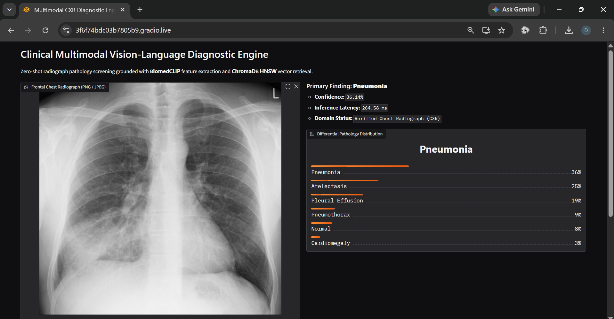
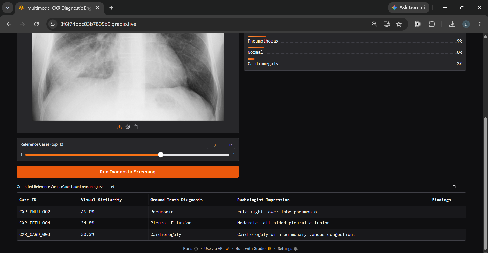
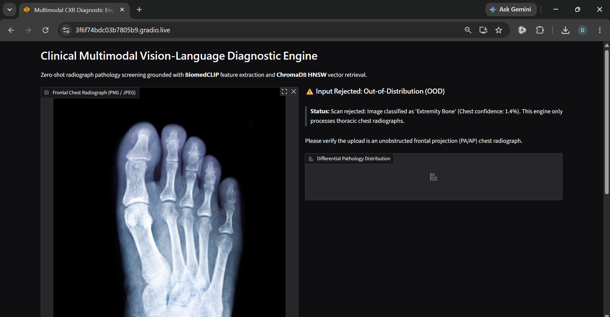

# Clinical Multimodal VLM & Diagnostic Retrieval Engine

An end-to-end multimodal diagnostic pipeline aligning chest radiograph visual representations with clinical text findings in a shared 512-dimensional latent space using Microsoft's BiomedCLIP (PubMedBERT + ViT-B/16) and dense vector retrieval.

## Architecture Overview
1. **Visual & Text Alignment Tower:** Pretrained BiomedCLIP backbone extracting unit-normalized 512-D vectors for cross-modal similarity scoring.
2. **Dense Vector Index:** ChromaDB nearest-neighbor retrieval layer for historically verified reference case matching.
3. **Grounded Diagnostic Generation:** Multimodal Vision-Language Model conditioning to generate structured radiology reports (Findings & Impression).

## Setup & Execution
```bash
python -m venv .venv
# Activate environment
pip install -r requirements.txt
python embedder.py
```

## Features Implemented
- [x] **Dual-Encoder Latent Alignment (`embedder.py`):** 512-D normalized feature extraction across medical vision and clinical text domains using BiomedCLIP.
- [x] **Zero-Shot Diagnostic Screening (`zero_shot_classifier.py`):** Multi-label pathology screening via temperature-scaled cosine similarity over clinical prompts without task-specific training heads.
- [ ] **Multimodal Vector Index:** ChromaDB reference case indexing & nearest-neighbor retrieval.
- [ ] **Grounded VLM Reporting:** Structured findings generation conditioned on retrieved case context.

## Clinical Scope & Target Pathologies

The engine is calibrated specifically for **frontal chest radiographs (PA and AP projections)**. Non-thoracic images or off-axis anatomical scans are filtered out at the API boundary by the out-of-distribution (OOD) guardrail before inference.

Currently, zero-shot screening computes differential probability distributions across six cardiopulmonary conditions:

| Pathology | Target Radiographic Biomarkers |
| :--- | :--- |
| **Normal** | Clear lung fields, preserved cardiothoracic ratio ($< 0.5$), sharp bilateral costophrenic angles. |
| **Pneumonia** | Airspace consolidation, patchy or segmental focal opacities, air bronchograms. |
| **Cardiomegaly** | Transverse cardiac diameter exceeding 50% of the maximum thoracic inner diameter. |
| **Pleural Effusion** | Blunting or obliteration of the costophrenic sulci, dependent fluid meniscus signs. |
| **Atelectasis** | Linear platelike opacities, local volume reduction, mediastinal or fissural shifting. |
| **Pneumothorax** | Distinct visceral pleural line without peripheral pulmonary vascular markings. |

> **Note:** Zero-shot classification scores candidate text embeddings against normalized visual projections. Expanding detection to other chest abnormalities (e.g., pulmonary edema or nodular patterns) requires adding their clinical anchor descriptions to the zero-shot prompt dictionary and vector index.

## Interface & Inference Workflow

### 1. In-Domain Frontal Chest Screening
Full multimodal inference pipeline evaluating differential pathologies and retrieving grounded reference cases from the vector index.





### 2. Out-of-Distribution (OOD) Guardrail
When a non-thoracic scan (such as a lower-extremity or abdominal radiograph) is submitted, the embedding domain filter detects out-of-distribution cosine similarity scores and rejects the scan before diagnostic calculation.



## Performance Benchmarks

Tested inside the Docker container on CPU across 25 runs using a real chest radiograph:

| Metric | Result |
| :--- | :--- |
| **Median Latency (P50)** | 675 ms |
| **P95 Latency** | 895 ms |
| **Average Latency** | 696 ms |
| **Throughput** | ~1.4 scans/sec |

Each run tests the complete pipeline from scratch: image processing, anatomical guardrail check, zero-shot pathology classification (BiomedCLIP), and similar cohort retrieval via ChromaDB.